# duelbeat — web_app Architecture

**duelbeat** is a 4-key browser rhythm game (lanes on **D F J K**), offline-first: all gameplay,
judgement, rendering, and chart import run client-side with zero backend dependency. The only
server component is a smoke-test Cloudflare Worker (§10). This document is the senior-engineer
handoff: how the web_app is wired, which contracts and invariants hold it together, and where to
change what.

- **Scope**: `web_app/game/` (pnpm workspace: Next.js game client, shared formula packages,
  asset tooling, worker, CI).
- **State**: end of W2 — play loop, import pipeline, calibration, atlas rendering, worker smoke,
  CI gates all landed.
- **HEAD**: `74f6d0a`. All `path:line` citations are relative to the worktree root and were
  spot-verified against this revision.
- **Diagrams**: 12 mermaid diagrams embedded at their topical positions; sources live in
  [`diagrams/`](diagrams/README.md) (`.mmd` = source of truth, `.svg`/`.png` = renders).

---

## 1. Monorepo map

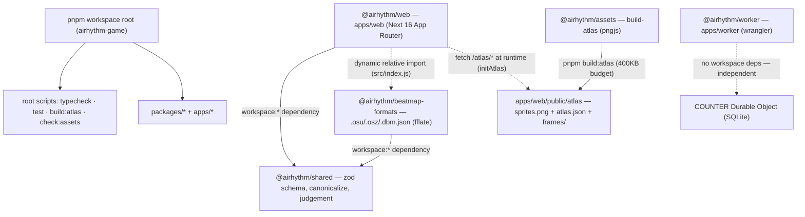

*Workspace layers and who-imports-whom — [SVG](diagrams/monorepo-layers.svg) | [PNG](diagrams/monorepo-layers.png)*

Five packages plus root scripts, wired so that **pure logic sits at the bottom and nothing
imports the app**:

- **Workspace root** `web_app/game/` — globs `packages/*` + `apps/*`
  (`web_app/game/pnpm-workspace.yaml:1-3`); root scripts `typecheck`/`test` run `pnpm -r`,
  plus `check:assets` and `build:atlas` (`web_app/game/package.json:7-12`); Node ≥22, pnpm
  pinned via `packageManager` (`web_app/game/package.json:4,13`).
- **`apps/web` (`@airhythm/web`)** — Next.js 16.3.8 App Router game client; depends on
  `@airhythm/shared` (`workspace:*`) plus next/react 19.3
  (`web_app/game/apps/web/package.json:14-19`); `dev`/`build` use `--webpack` (D15), `e2e` is
  `playwright test` (`web_app/game/apps/web/package.json:5-13`).
- **`apps/worker` (`airhythm-worker`)** — Cloudflare Worker + Durable Object smoke service; no
  workspace deps; entry `src/index.ts`, DO `src/counter-do.ts`, binding `COUNTER`
  (`web_app/game/apps/worker/wrangler.toml:1-11`).
- **`packages/shared` (`@airhythm/shared`)** — pure formulas + zod beatmap schema; sole dep
  `zod` 4.6.5 (`web_app/game/packages/shared/package.json:13-15`); barrel re-exports
  config/constants/judgement/beatmap/canonical (`web_app/game/packages/shared/src/index.ts:1-7`).
- **`packages/beatmap-formats` (`@airhythm/beatmap-formats`)** — .osu/.osz/.dbm.json
  importers/exporters; deps `@airhythm/shared` + `fflate`
  (`web_app/game/packages/beatmap-formats/package.json:13-16`).
- **`packages/assets` (`@airhythm/assets`)** — shelf packer (`src/pack.ts`) + atlas builder CLI
  (`src/build-atlas.ts`); dep `pngjs` (`web_app/game/packages/assets/package.json:18-20`).
- **`scripts/` (root)** — `check-assets.mjs` license gate, `smoke.mjs` worker post-deploy smoke
  (`web_app/game/scripts/check-assets.mjs:1`,
  `web_app/game/scripts/smoke.mjs:1-12`).

**Dependency direction** (the rule that keeps the workspace honest):

- `apps/web` → `@airhythm/shared` (`web_app/game/apps/web/package.json:15`); page code imports
  engine/ui/calibration locally under `apps/web/src/`.
- `apps/web` → `packages/beatmap-formats` via **relative dynamic import, NOT a declared dep**
  (deliberate — package.json was off-limits: `web_app/game/apps/web/src/app/import/page.tsx:65-68,101-106`).
- `beatmap-formats` → `shared`; `shared` → `zod` only (leaf); `assets` → `pngjs` (leaf,
  build-time); `worker` → nothing in-workspace; root `scripts/` → node builtins only.
- One-way: nothing imports `apps/web`; `shared` imports nobody internal.

---

## 2. Routes / pages

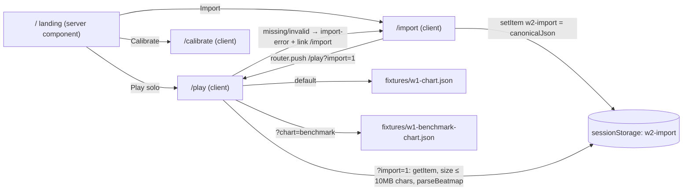

*Four routes and the sessionStorage hand-off — [SVG](diagrams/routes-pages.svg) | [PNG](diagrams/routes-pages.png)*

- **`/`** (`web_app/game/apps/web/src/app/page.tsx:4-34`) — server component (no `"use client"`),
  renders `GAME_NAME` ("duelbeat", `web_app/game/packages/shared/src/config.ts:1`) plus links to
  `/play`, `/calibrate`, `/import`.
- **`/play`** (`web_app/game/apps/web/src/app/play/page.tsx:1`) — `"use client"`; the game.
  Phase machine `Phase = "idle" | "loading" | "countdown" | "playing" | "paused"`
  (`play/page.tsx:22-23`), with `applyPhase` writing `phaseRef` **before** React state so
  re-entrant calls (defensive double clicks, e2e) see the new phase synchronously
  (`play/page.tsx:73-76`). Engine/clock/renderer/perf live in refs (`play/page.tsx:55-71`);
  HUD reads a `SnapshotStore` via `useSyncExternalStore` (`play/page.tsx:42-46`,
  `web_app/game/apps/web/src/ui/snapshot-store.ts:4-31`); UI-only state (lanes, countdown,
  toasts) uses `useState` (`play/page.tsx:47-52`).
- **`/import`** (`web_app/game/apps/web/src/app/import/page.tsx:1`) — `"use client"`; file input
  for `.osu,.osz,.dbm.json` (`import/page.tsx:151`); success → summary + "Play" →
  `router.push("/play?import=1")` (`import/page.tsx:205-217`).
- **`/calibrate`** (`web_app/game/apps/web/src/app/calibrate/page.tsx:1`) — `"use client"`;
  phase `idle | running | done` (line 17); 20 metronome beats @500 ms, ≥16 tap/beat pairs,
  median offset → `saveCalibration` (`calibrate/page.tsx:9-14,40-53,147-151`).
- Root layout: Inter + JetBrains Mono, title "duelbeat"
  (`web_app/game/apps/web/src/app/layout.tsx:5-9`). Route list also in `web_app/game/README.md:32`.

The import → play hand-off is deliberately **sessionStorage + query flag**, not a shared store:
`/import` writes canonical JSON under `w2-import` (`import/page.tsx:60-63`), `/play?import=1`
reads and re-validates it (§6), and a failure renders an error overlay linking back to `/import`
instead of starting (`play/page.tsx:143-153,394-411`). Charts never travel through the URL.

---

## 3. Play flow lifecycle (`apps/web/src/app/play/page.tsx`)

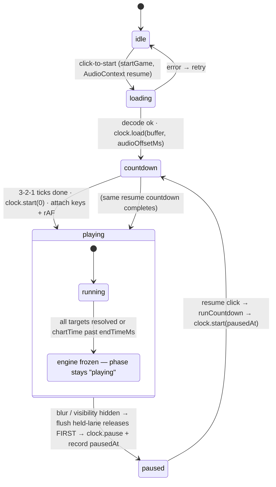

*Play phase state machine (note: freeze does not change phase) — [SVG](diagrams/play-phase-state-machine.svg) | [PNG](diagrams/play-phase-state-machine.png)*

**Transitions.** `idle → loading → countdown → playing` on start; `playing → paused →
countdown → playing` on pause/resume; any error → back to `idle` so the click-to-start button
offers retry (`play/page.tsx:248-249,288-291,113,129,371`). The sync guard is
`phaseRef`-written-before-`setPhase` (`play/page.tsx:73-76`).

**Mount effect** (`play/page.tsx:134-224`): resolves the chart (`?chart=benchmark` → bench
fixture; truthy `?import=` → `sessionStorage["w2-import"]` with a 10 MB char cap →
`parseBeatmap`; failure → `importError`, early `return` with no renderer/listeners), constructs
the renderer, wires `resize`/`blur`/`visibilitychange` → `pauseGame`, and on cleanup aborts
in-flight `startGame` via `mountedRef`, cancels rAF/timers, `clock.stop()`, closes the
AudioContext, deletes `__w2`, and `renderer.dispose()`.

> **B6 contract**: `canvas.dataset.webglReady = "true"` is set **only after** the
> `WebGLRenderer` constructor succeeds (it throws when WebGL2 is unavailable). The e2e waits on
> this attribute instead of calling `getContext()` itself — which would succeed even if the app
> never initialized a renderer (`play/page.tsx:157-161`).

**Important code — mount effect: import consumption, B6 ordering, opportunistic atlas, `__w2` gating**
(verbatim from `web_app/game/apps/web/src/app/play/page.tsx:134-191`, ellipses mark omitted lines):

```ts
  useEffect(() => {
    const canvas = canvasRef.current;
    if (!canvas) return;
    mountedRef.current = true; // re-arm on (Strict Mode) remount
    const params = new URLSearchParams(window.location.search);
    const benchmark = params.get("chart") === "benchmark";
    // W2 T18: truthy ?import= → resolve chart from sessionStorage before fixture selection;
    // missing/invalid → inline error + link to /import (no renderer, no start overlay)
    let chart: Beatmap;
    if (!benchmark && params.get("import")) {
      try {
        const raw = sessionStorage.getItem("w2-import");
        if (!raw) throw new Error("w2-import missing from sessionStorage");
        if (raw.length > MAX_IMPORT_JSON_CHARS) throw new Error("w2-import exceeds size limit");
        chart = parseBeatmap(JSON.parse(raw));
      } catch (err) {
        console.error("[play] imported chart failed to load:", err);
        setImportError(true);
        return; // mount effect exits without renderer / __w2 / listeners
      }
    } else {
      chart = parseBeatmap(benchmark ? benchChart : w1Chart);
    }
    const renderer = new WebGLRenderer(canvas, chart);
    // signal ONLY after the renderer's constructor succeeded (it throws if WebGL2 is
    // unavailable) — the B6 e2e waits on this attribute instead of calling getContext()
    // itself, which would succeed even if the app never initialized the renderer
    canvas.dataset.webglReady = "true";
    // W2 T22: atlas load is opportunistic — kicked off AFTER readiness and never awaited
    // (gameplay never blocks on assets, spec §6.4); rejection consumed so the permanent
    // code-drawn fallback can't surface as an unhandled rejection in the B6 e2e
    renderer.initAtlas().catch(() => {});
    // ... (PerfMonitor creation omitted — must live inside the effect, not component scope)
    // I3: live-game debug hook is a timing side-channel for any XSS on this origin.
    // Dev builds get it; production builds only when explicitly opted in — the
    // Playwright webServer sets NEXT_PUBLIC_E2E=1 (inlined at `pnpm build`, since its
    // webServer runs `pnpm build && pnpm start`). Vercel builds leave it unset → absent.
    if (process.env.NODE_ENV === "development" || process.env.NEXT_PUBLIC_E2E === "1") {
      window.__w2 = { /* chartTimeMs / playbackPositionMs / phase / noteCount */ };
    }
    // ... (resize/blur/visibilitychange listeners + cleanup omitted)
```

What this implements: the size-gated import contract (§6) fails closed before any renderer is
constructed; `webglReady` is the B6 readiness signal with causality preserved (attribute ⇒
constructor succeeded); `initAtlas()` is fire-and-forget so the code-drawn fallback can never
block or crash gameplay (§8); `__w2` — a live timing side-channel — is gated to dev/E2E builds
only (§12).

**Important code — `pauseGame` / `resumeGame` ordering**
(verbatim from `web_app/game/apps/web/src/app/play/page.tsx:98-131`):

```ts
  const pauseGame = (): void => {
    if (phaseRef.current !== "playing") return;
    const clock = clockRef.current;
    const engine = engineRef.current;
    if (!clock) return;
    flushHeldLanesBeforePause({
      heldLanes: heldLanesRef.current,
      releaseAt: (lane) => {
        if (!engine || engine.isFrozen()) return;
        engine.release(lane, clock.chartTimeAt(performance.now())); // input-domain time, pre-pause
        store.set(engine.snapshot());
      },
      pause: () => {
        clock.pause(); // T7: freezes chartTime/playbackPosition — never throws
        const pausedAt = clock.chartTimeMs(); // frozen value, not a live reading
        pauseCtlRef.current?.pause(pausedAt);
        applyPhase("paused");
      },
    });
  };

  const resumeGame = (): void => {
    if (phaseRef.current !== "paused") return;
    const clock = clockRef.current;
    if (!clock) return;
    const at = pauseCtlRef.current?.pausedAtMs ?? 0;
    setResuming(true);
    runCountdown(() => {
      clock.start(at);
      pauseCtlRef.current?.clear();
      setResuming(false);
      applyPhase("playing");
    });
  };
```

This encodes the pause ruling in one structure: **flush held-lane releases first** (at
input-domain time, while the clock still runs), **then freeze**, then record the position
exactly once (`SoloPauseController.pause` only records when `recorded === null`,
`web_app/game/apps/web/src/engine/pause-controller.ts:3-6`), then show the overlay. Resume is
the mirror: wall-clock 3-2-1 → `clock.start(at)` at the recorded `pausedAtMs` →
`pauseCtl.clear()` → `playing`. Releases use `clock.chartTimeAt(performance.now())` — the input
domain — never render `chartTimeMs()`, because the clock is still running at that moment.

**Important code — `startGame` lifecycle spine**
(verbatim from `web_app/game/apps/web/src/app/play/page.tsx:247-365`, ellipses mark omitted lines):

```ts
  const startGame = async (): Promise<void> => {
    if (phaseRef.current !== "idle") return; // defensive second clicks (e2e) are no-ops
    applyPhase("loading");
    try {
      const audioCtx = new AudioContext();
      audioCtxRef.current = audioCtx;
      await audioCtx.resume(); // user gesture from the click unlocks playback
      if (!mountedRef.current) return; // unmounted mid-await: cleanup already closed the ctx
      const res = await fetch("/audio/click-track.wav");
      const audioData = await res.arrayBuffer();
      if (!mountedRef.current) return;
      const buffer = await audioCtx.decodeAudioData(audioData); // "Preparing…" while decoding
      if (!mountedRef.current) return; // never schedule the countdown on a dead page
      // ... (chart/renderer/perf init guards + ClockPairKeeper with defensive getOutputTimestamp read omitted)
      const clock = new AudioClock(audioCtx, pairKeeper);
      clock.load(buffer, chart.song.audioOffsetMs);
      clockRef.current = clock;
      // outputLatency → first-run default guess (spec §4.5); stored calibration wins inside loadCalibration
      const engine = new GameEngine({
        chart,
        clock,
        renderer,
        perf,
        deviceCalibrationOffsetMs: loadCalibration(audioCtx.outputLatency),
      });
      // ... (store.set(engine.snapshot()), engineRef/heldLanes wiring omitted)
      // 3-2-1 countdown (wall-clock, solo form), then AudioClock.start(0)
      runCountdown(() => {
        clock.start(0);
        applyPhase("playing");
        const rawKey = createKeyHandler({
          inputChartTime: (ts) => clock.chartTimeAt(ts),
          engine: {
            // wrap judge: emit snapshot at keydown so HUD updates without waiting a frame (§2.3)
            isFrozen: () => engine.isFrozen(),
            judge: (lane, time) => {
              engine.judge(lane, time);
              store.set(engine.snapshot());
            },
          },
          onAccepted: (lane) => {
            heldLanesRef.current.add(lane); // W2 T17: track held lanes for blur flush
            // ... (activeLanes flash wiring omitted)
          },
        });
        // ... (createReleaseHandler + phase-guarded key listeners omitted)
        const frame = (rafMs: number) => {
          // ... (perf frame-interval + non-playing skip-branch omitted)
          if (engine.isFrozen()) {
            const report = {
              p95RenderDurationMs: perf.p95RenderDurationMs(),
              p95UpdateDurationMs: perf.p95UpdateDurationMs(),
              p95FrameIntervalMs: perf.p95FrameIntervalMs(),
              samples: perf.sampleCounts(),
              pass: perf.p95RenderDurationMs() <= RENDER_BUDGET_MS,
              chart: benchmarkRef.current ? "benchmark" : "w1",
            };
            console.log("[perf]", report);
            store.set(engine.snapshot()); // final frozen snapshot reaches HUD
            return;
          }
          const t0 = performance.now();
          store.set(engine.update());
          perf.recordUpdateDuration(performance.now() - t0);
          rafRef.current = requestAnimationFrame(frame);
        };
        rafRef.current = requestAnimationFrame(frame);
      });
    } catch (err) {
      console.error("[play] start failed:", err);
      // ... (AudioContext teardown omitted)
      applyPhase("idle"); // allow retry
    }
  };
```

The lifecycle, in order: **gesture-bound AudioContext** (autoplay policy — the context is
created and resumed *inside* the click handler) → fetch/decode the click-track (each `await`
guarded by `mountedRef` so an unmounted page never schedules timers) → `ClockPairKeeper` +
`AudioClock.load(buffer, chart.song.audioOffsetMs)` → `GameEngine` construction consuming
stored calibration (fallback `outputLatency` guess, §4) → wall-clock 3-2-1 → `clock.start(0)` →
input wiring where **judgement time always comes from `inputChartTime: (ts) => clock.chartTimeAt(ts)`**
(§4) → rAF loop whose non-playing branch keeps the loop alive but skips update/render, and which
prints the `[perf]` p95 report against `RENDER_BUDGET_MS` (16.7,
`web_app/game/apps/web/src/engine/perf.ts:2`) when the engine freezes.

Also on this page: a device-change poll running **only while `playing`** (2 s interval +
`sinkchange` dirty mark) that raises a "recalibrate" toast (`play/page.tsx:229-244`,
detector `web_app/game/apps/web/src/engine/device-change.ts:4-25`).

---

## 4. Timing model (buffer ↔ chartTime ↔ calibrated input)

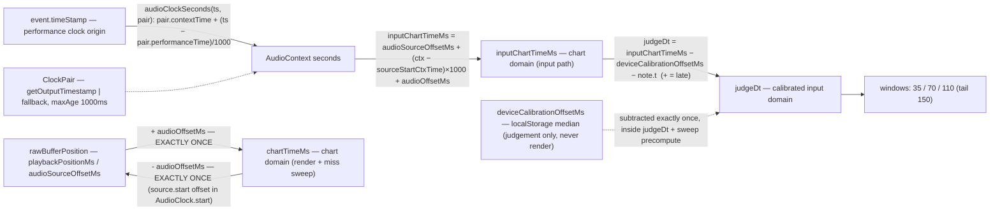

*The three time domains and the once-only offset rule — [SVG](diagrams/timing-domains.svg) | [PNG](diagrams/timing-domains.png)*

This is the section where bugs are cheapest to prevent and hardest to debug, so the rules are
stated as invariants, not conventions:

1. **Single-source invariant**: `chartTime = rawBufferPosition + audioOffsetMs`; the inverse
   subtracts once; **`audioOffsetMs` is applied EXACTLY ONCE per conversion — never twice**
   (`web_app/game/apps/web/src/engine/time-math.ts:1-6`). Buffer-domain and chart-domain values
   never mix inside one expression.
2. **Two clocks, two domains**: the *render path* reads `clock.chartTimeMs()` (live formula when
   running, frozen snapshot when paused); the *input path* converts the DOM
   `event.timeStamp` through the perf↔ctx pair first (§ below). They meet only inside
   `judgeDt`, and both are converted — **the two domains never mix**
   (`web_app/game/apps/web/src/engine/engine.ts:16`, controller comment `controller.ts:23`).
3. **Calibration is input-path only**: `deviceCalibrationOffsetMs` is subtracted exactly once,
   inside `judgeDt` and the expiry precompute — never from render `chartTime`
   (auto-miss sweep keeps render time as one of its two domains).

**Important code — time-domain invariant + the three conversion formulas**
(verbatim from `web_app/game/apps/web/src/engine/time-math.ts:1-43`, interfaces elided):

```ts
// apps/web/src/engine/time-math.ts
// Time-domain invariant (spec §4.2, single source of truth):
//   chartTime = rawBufferPosition + audioOffsetMs
//   rawBufferPosition = chartTime − audioOffsetMs
//   serverSongMs is chart-domain; desiredPlaybackPosition is always buffer-domain.
//   audioOffsetMs is applied EXACTLY ONCE per conversion — never twice.
// ... (ChartTimeInput / PairSource / ClockPair type declarations omitted)

export function chartTime(i: ChartTimeInput): number {
  return i.audioSourceOffsetMs + (i.ctxCurrentTime - i.sourceStartCtxTime) * 1000 + i.audioOffsetMs;
}
// ...
export function audioClockSeconds(timeStampMs: number, pair: ClockPair): number {
  return pair.contextTimeSeconds + (timeStampMs - pair.performanceTimeMs) / 1000;
}

export function inputChartTimeMs(
  timeStampMs: number,
  pair: ClockPair,
  ctx: { sourceStartCtxTime: number; audioSourceOffsetMs: number; audioOffsetMs: number },
): number {
  const ctxSeconds = audioClockSeconds(timeStampMs, pair);
  return ctx.audioSourceOffsetMs + (ctxSeconds - ctx.sourceStartCtxTime) * 1000 + ctx.audioOffsetMs;
}

export function judgeDt(inputChartTimeMsValue: number, deviceCalibrationOffsetMs: number, noteTargetTimeMs: number): number {
  return inputChartTimeMsValue - deviceCalibrationOffsetMs - noteTargetTimeMs;
}
```

These four functions are the entire timing kernel. `chartTime` is the render-domain formula;
`audioClockSeconds` is **the bridge** that maps a DOM `event.timeStamp` (performance clock)
into AudioContext seconds via a sampled pair; `inputChartTimeMs` composes the bridge with the
same chart conversion the render path uses; `judgeDt` then subtracts device calibration once so
selection and grading share one calibrated domain (positive `dt` = late). Every caller is
required to go through these — no page, handler, or test reimplements the arithmetic.

**Important code — `AudioClock.start()` / `pause()`**
(verbatim from `web_app/game/apps/web/src/engine/audio-clock.ts:36-56`):

```ts
  start(atChartMs = 0): void {
    if (this.pendingBuffer === null) throw new Error("load() before start()");
    this.source?.stop();
    const raw = Math.max(0, atChartMs - this.audioOffsetMs); // chart → buffer: subtract offset ONCE
    this.audioSourceOffsetMs = raw;
    this.sourceStartCtxTime = this.ctx.currentTime;
    const src = this.ctx.createBufferSource();
    src.buffer = this.pendingBuffer;
    src.start(this.sourceStartCtxTime, raw / 1000);
    this.source = src;
    this.state = "running";
  }

  pause(): void {
    if (this.state !== "running") return;
    this.pausedChartMs = this.chartTimeMs();
    this.pausedPosMs = this.playbackPositionMs();
    this.source?.stop();
    this.source = null;
    this.state = "paused";
  }
```

`start()` is the chart→buffer direction of the EXACTLY-ONCE rule: `raw = atChartMs −
audioOffsetMs` feeds `AudioBufferSourceNode.start(when, offset)` directly, and the anchors
(`audioSourceOffsetMs`, `sourceStartCtxTime`) are re-established so the forward formula in
§time-math reconstructs the same chart time. `pause()` snapshots **both domains in lockstep**
(`pausedChartMs`, `pausedPosMs`) and never throws — a paused clock still answers
`chartTimeMs()`/`playbackPositionMs()` from the frozen values (`audio-clock.ts:58-77`), which is
what lets pause/resume and the HUD survive mid-playback. `stop()` is teardown only and is
called solely from the play-page cleanup (`play/page.tsx:210`); the resume path re-uses
`start(at)`.

**Important code — the perf↔ctx bridge and its 1 s cache**
(verbatim from `web_app/game/apps/web/src/engine/clock-pair.ts:4-33`):

```ts
export function samplePair(
  ctx: { currentTime: number },
  perfNowMs: number,
  readOutputTimestamp?: () => { performanceTime: number; contextTime: number } | null,
): ClockPair {
  const t = readOutputTimestamp?.();
  if (t && Number.isFinite(t.performanceTime) && Number.isFinite(t.contextTime)) {
    return { performanceTimeMs: t.performanceTime, contextTimeSeconds: t.contextTime, source: "getOutputTimestamp", sampledAt: perfNowMs };
  }
  // fallback: labels honestly — NOT output-device-truthful (spec §4.1)
  return { performanceTimeMs: perfNowMs, contextTimeSeconds: ctx.currentTime, source: "fallback", sampledAt: perfNowMs };
}

export class ClockPairKeeper {
  private cached: ClockPair | null = null;
  constructor(
    private readonly ctx: { currentTime: number },
    private readonly opts?: {
      readOutputTimestamp?: () => { performanceTime: number; contextTime: number } | null;
      maxAgeMs?: number;
    },
  ) {}
  get(nowMs: number): ClockPair {
    const maxAge = this.opts?.maxAgeMs ?? 1000;
    if (this.cached === null || nowMs - this.cached.sampledAt >= maxAge) {
      this.cached = samplePair(this.ctx, nowMs, this.opts?.readOutputTimestamp);
    }
    return this.cached;
  }
}
```

A `ClockPair` anchors performance-clock time to AudioContext time. `samplePair` prefers
`getOutputTimestamp()` when both fields are finite (output-device truth) and otherwise returns
an **honestly-labeled `fallback`** — the `source` field exists so logs/tests can never mistake
one for the other. `ClockPairKeeper` caches the pair and resamples at `maxAgeMs` (default
1000 ms), trading staleness for call frequency; the play page injects a defensive
`readOutputTimestamp` because lib.dom types the timestamp fields as optional
(`play/page.tsx:264-272`).

Resync plumbing for a future server (`computeResyncTarget` chart→buffer "subtract once" with
`[0, audioDuration]` clamp, plus `DriftGuard` at 250 ms threshold / 2000 ms sustain) sits in
`web_app/game/apps/web/src/engine/server-time.ts:33-63`; the ping loop itself is deferred to W4.

### Calibration flow (`/calibrate` → `judgeDt`)

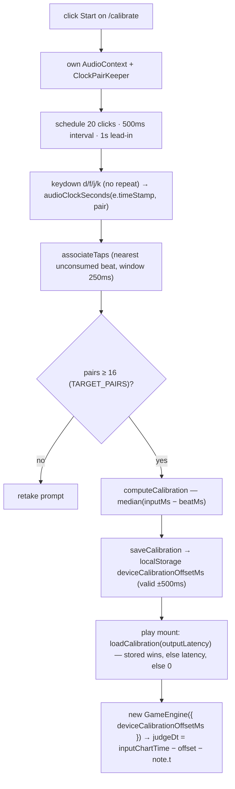

*Calibration measurement through to consumption in judgeDt — [SVG](diagrams/calibration-flow.svg) | [PNG](diagrams/calibration-flow.png)*

Calibration corrects for output latency + human offset as a single number. The `/calibrate`
page schedules beats on the audio clock and converts taps with
`audioClockSeconds(e.timeStamp, pair)*1000` (`calibrate/page.tsx:63-64,107-123`) — **the same
provenance math as gameplay**, which is the point: a calibration measured in any other domain
would be worthless. It requires ≥16 tap/beat pairs (`TARGET_PAIRS`,
`calibrate/page.tsx:12,42-44`), pairs greedily to nearest unconsumed beat within 250 ms with
no cascade on reject (`associateTaps`,
`web_app/game/apps/web/src/calibration-store.ts:39-59`), and takes the median of diffs
(`computeCalibration`, `calibration-store.ts:31-36`).

Storage is `localStorage["deviceCalibrationOffsetMs"]` with a validity gate: finite AND within
±500 ms (`calibration-store.ts:16-19`); `saveCalibration` throws outside that range
(`calibration-store.ts:26-29`), and `loadCalibration(outputLatency?)` returns the stored value
if valid, else `outputLatency*1000`, else 0 (`calibration-store.ts:4-24`). Consumption is at
engine construction: `loadCalibration(audioCtx.outputLatency)` (`play/page.tsx:282`) →
`GameEngine.deviceCalibrationOffsetMs` (`engine/engine.ts:52`).

---

## 5. Judgement engine (`apps/web/src/engine/engine.ts`)

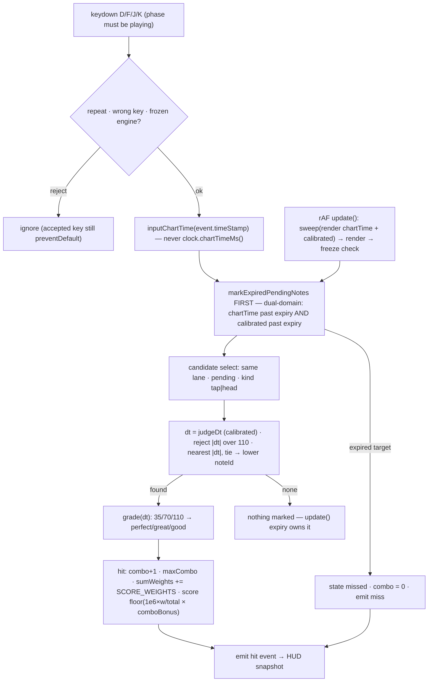

*Judgement pipeline from keydown to snapshot — [SVG](diagrams/judgement-pipeline.svg) | [PNG](diagrams/judgement-pipeline.png)*

**Target model** — built once in the constructor: a tap note → one `tap` target; a hold note →
`head(t)` + `tail(t+d)`; `totalTargets = taps + 2×holds = targets.length`, which is the
denominator for score and accuracy. `endTimeMs` = max target deadline, where deadlines are
tap/head `+AUTO_MISS_MS` and tail `+TAIL_WINDOW_MS` — and `AUTO_MISS_MS` is *defined as*
`JUDGE_WINDOWS.good`, never restated (`engine/engine.ts:8,53-71`).

**Important code — target model**
(verbatim from `web_app/game/apps/web/src/engine/engine.ts:53-71`):

```ts
    // Target model (W2 T17): tap → (id, "tap"); hold → (id, "head") + (id, "tail");
    // totalTargets = taps + 2×holds = targets.length — score/accuracy denominators.
    this.targets = [];
    for (const [noteIdx, note] of opts.chart.notes.entries()) {
      if (note.type === "hold") {
        const d = note.d ?? 0;
        this.targets.push({ noteIdx, noteId: note.id, lane: note.lane, kind: "head", targetMs: note.t, state: "pending" });
        this.targets.push({ noteIdx, noteId: note.id, lane: note.lane, kind: "tail", targetMs: note.t + d, state: "pending" });
      } else {
        this.targets.push({ noteIdx, noteId: note.id, lane: note.lane, kind: "tap", targetMs: note.t, state: "pending" });
      }
    }
    this.totalTargets = this.targets.length;
    this.states = opts.chart.notes.map(() => "pending");
    // endTimeMs = last target's deadline (tap/head: t+110; tail: t+d+150) — tap-only charts keep max(t)+110
    this.endTimeMs =
      this.totalTargets === 0
        ? opts.chart.song.durationMs
        : Math.max(...this.targets.map((t) => t.targetMs + (t.kind === "tail" ? TAIL_WINDOW_MS : AUTO_MISS_MS)));
```

Why two levels: the renderer shows per-**note** states (`pending | hit | missed`, collapsed by
`syncStates`, `engine/engine.ts:211-223`) while scoring counts per-**target** outcomes — a hold
scores head and tail independently. The empty-chart branch (fall back to `song.durationMs`)
exists because `Math.max()` of an empty array is `-Infinity`; the `length > 0` guard reappears
in `update()` for the same vacuous-truth reason.

**Important code — `judge()` and `release()` contracts**
(verbatim from `web_app/game/apps/web/src/engine/engine.ts:76-152`, emit/cleanup elided):

```ts
  judge(lane: number, inputMs: number): void {
    if (this.frozen) throw new Error("engine frozen"); // contract defined here; unreachable until B5 activates freeze (tested in B5)
    const calibratedInputMs = inputMs - this.deviceCalibrationOffsetMs;
    const events = this.markExpiredPendingNotes(inputMs, calibratedInputMs);

    let bestIdx = -1;
    let bestDt = 0;
    let bestAbs = Infinity;
    for (const [i, target] of this.targets.entries()) {
      if (target.lane !== lane || target.state !== "pending") continue;
      if (target.kind !== "tap" && target.kind !== "head") continue; // judge resolves head/tap only; tails wait for release/expiry
      const dt = judgeDt(inputMs, this.deviceCalibrationOffsetMs, target.targetMs); // selection + grading share the calibrated domain (spec §7.1)
      const abs = Math.abs(dt);
      if (abs > JUDGE_WINDOWS.good) continue; // same bound as AUTO_MISS_MS — both derive from JUDGE_WINDOWS.good
      const tie = bestIdx !== -1 && target.noteId < this.targets[bestIdx]!.noteId;
      if (abs < bestAbs || (abs === bestAbs && tie)) {
        bestAbs = abs;
        bestIdx = i;
        bestDt = dt;
      }
    }

    if (bestIdx !== -1) {
      const target = this.targets[bestIdx]!;
      const g = grade(bestDt); // |bestDt| ≤ good → can never be "miss" (controller ruling, W2 T9)
      target.state = "hit";
      this.combo += 1;
      if (this.combo > this.maxCombo) this.maxCombo = this.combo;
      this.sumWeights += SCORE_WEIGHTS[g];
      events.push({ type: "hit", grade: g, lane, dt: bestDt, noteId: target.noteId });
    }
    // head miss-by-window: nothing marked — stays pending; update() expiry owns it (Review Focus 5)
    // ... (syncStates + snapshot emit omitted)

  release(lane: number, inputMs: number): void {
    if (this.frozen) throw new Error("engine frozen");
    const events = this.markExpiredPendingNotes(inputMs, inputMs - this.deviceCalibrationOffsetMs);
    // ... (first pending tail lookup omitted)
    if (tailIdx !== -1) {
      const tail = this.targets[tailIdx]!;
      // ONE calibrated timing domain for every branch (controller ruling, W2 T17)
      const dt = judgeDt(inputMs, this.deviceCalibrationOffsetMs, tail.targetMs);
      if (dt < -150) {
        // early release → tail Miss immediately
        tail.state = "missed";
        this.combo = 0;
        events.push({ type: "miss", lane, chartTime: inputMs });
      } else if (dt <= 150) {
        const g = gradeTail(dt); // |dt| ≤ 150 → perfect/great/good; miss unreachable via release
        tail.state = "hit";
        this.combo += 1;
        if (this.combo > this.maxCombo) this.maxCombo = this.combo; // successful tail increments maxCombo too (full-combo hold = totalTargets)
        this.sumWeights += SCORE_WEIGHTS[g];
        events.push({ type: "hit", grade: g, lane, dt, noteId: tail.noteId });
      }
      // dt > 150 → ignore; the deadline already passed — update() owns expiry
    }
    // ... (syncStates + snapshot emit omitted)
```

Contract points: both methods throw when frozen (the input layer pre-guards, so in-game this is
unreachable — `controller.ts:22`, `release.ts:16`, `play/page.tsx:323-331`); **every hit
sweeps expiry first** so stale targets cannot be judged; candidate selection scans only
`pending` `tap|head` targets in the same lane within ±110 ms, nearest `abs(dt)` wins, ties break
to lower `noteId`; a hit can never grade as miss inside the window; a head that falls out of
window is **not** marked by `judge` — expiry owns it (so a missed head never touches its tail);
release uses one calibrated domain for all three branches — early (`dt < −150`) is an immediate
tail miss + combo reset, in-window grades via `gradeTail` (`miss` unreachable), late (`> 150`)
is ignored because `update()` owns expiry.

**Important code — `update()` freeze + dual-domain expiry**
(verbatim from `web_app/game/apps/web/src/engine/engine.ts:154-209`, perf/helpers elided):

```ts
  update(): GameSnapshot {
    if (this.frozen) throw new Error("engine frozen");
    const chartTime = this.clock.chartTimeMs();
    const events = this.markExpiredPendingNotes(chartTime, chartTime - this.deviceCalibrationOffsetMs);
    this.syncStates();
    this.renderer.render(chartTime, this.states);
    // ... (PerfMonitor render-duration bookkeeping omitted)
    // Freeze when ALL targets resolved OR chartTime > endTimeMs in BOTH domains
    // (W2 T9 review: chartTime > endTimeMs + max(calib, 0)); unresolved → already missed by sweep.
    // length check: an empty chart has no targets and must NOT freeze via every() (vacuous true).
    const allResolved = this.targets.length > 0 && this.targets.every((t) => t.state !== "pending");
    if (allResolved || (chartTime > this.endTimeMs && chartTime - this.deviceCalibrationOffsetMs > this.endTimeMs)) this.freeze();
    const next = this.emit(chartTime, events);
    this.prev = this.current;
    this.current = next;
    return next;
  }
  // ... (freeze/snapshot/isFrozen helpers omitted)

  /**
   * Miss only when overdue in BOTH domains (W2 T9 review): raw AND calibrated past
   * the target's deadline — tap/head: targetMs + 110; tail: targetMs + 150
   * (= (t+d) + 150). Equivalently deadline + max(calib, 0): positive calibration
   * never pre-ents a still-valid calibrated input; negative never expires early.
   * `calibratedChartTime` defaults to `chartTime` (raw) for single-domain callers.
   * A missed head never touches its tail (Review Focus 5).
   */
  protected markExpiredPendingNotes(chartTime: number, calibratedChartTime = chartTime): JudgementEvent[] {
    const events: JudgementEvent[] = [];
    for (const target of this.targets) {
      if (target.state !== "pending") continue;
      const expiryMs = target.targetMs + (target.kind === "tail" ? TAIL_WINDOW_MS : AUTO_MISS_MS);
      if (chartTime > expiryMs && calibratedChartTime > expiryMs) {
        target.state = "missed";
        this.combo = 0;
        events.push({ type: "miss", lane: target.lane, chartTime });
      }
    }
    return events;
  }
```

The **dual-domain expiry rule** is the ruling to preserve: a note is only missed when it is
overdue *both* as raw chart time *and* as calibrated chart time — equivalently
`deadline + max(calib, 0)` — so a positive calibration never pre-expires a still-valid input
and a negative one never expires early. Freeze happens when every target is resolved **or**
`chartTime` and the calibrated clock are both past `endTimeMs` (the `length > 0` guard blocks
vacuous `every()` freezing on an empty chart). Once frozen, `judge`/`release`/`update` all
throw — the phase stays `playing`, and the rAF loop reports perf and stops scheduling
(`play/page.tsx:346-357`).

**Input wiring — `event.timeStamp` provenance reaches `judge()`**
(verbatim from `web_app/game/apps/web/src/engine/controller.ts:16-43`, re-export elided):

```ts
export function createKeyHandler(deps: KeyHandlerDeps): (event: KeyboardEvent) => void {
  return (event: KeyboardEvent) => {
    if (event.repeat) return; // Review Focus #1
    const lane = laneForKey(event.key);
    if (lane === undefined) return; // Review Focus #1
    event.preventDefault(); // accepted gameplay key only
    if (deps.engine.isFrozen()) return; // frozen engine ignores gameplay input
    deps.engine.judge(lane, deps.inputChartTime(event.timeStamp)); // input time, never clock.chartTimeMs()
    deps.onAccepted?.(lane);
  };
}
// ... (createReleaseHandler re-export omitted)

/**
 * Review Focus 4 (W2 T17): release held lanes BEFORE pause records position.
 * Releases run over a copy, then the set is cleared, then pause — order asserted by test.
 */
export function flushHeldLanesBeforePause(deps: {
  heldLanes: Set<number>;
  releaseAt: (lane: number) => void;
  pause: () => void;
}): void {
  for (const lane of [...deps.heldLanes]) deps.releaseAt(lane);
  deps.heldLanes.clear();
  deps.pause();
}
```

Keydown → `createKeyHandler` → `deps.engine.judge(lane, deps.inputChartTime(event.timeStamp))`
where `inputChartTime` is `(ts) => clock.chartTimeAt(ts)` bound at start (`play/page.tsx:293`);
keyup goes through `createReleaseHandler` with the identical shape
(`web_app/game/apps/web/src/engine/release.ts:12-19`, bound at `play/page.tsx:314`). Held
lanes are tracked in `heldLanesRef` (add on accepted keydown, delete on keyup,
`play/page.tsx:303,330`), and `flushHeldLanesBeforePause` releases **over a copy, clears the
set, then pauses** — order asserted by test. Renders use `clock.chartTimeMs()` instead; the
auto-miss sweep stays on render chartTime as one of its two domains
(`engine/engine.ts:16`).

### Hold lifecycle

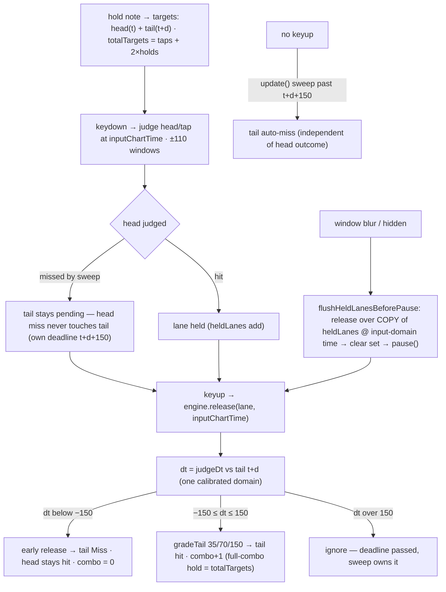

*Hold note head/tail lifecycle incl. blur flush — [SVG](diagrams/hold-lifecycle.svg) | [PNG](diagrams/hold-lifecycle.png)*

A hold is two independent targets sharing a note id. Head judges like a tap (±110). Tail
resolves only three ways: keyup in the ±150 window (graded, combo++), keyup before −150 (early
release → tail miss, head stays hit, combo reset), or no keyup → `update()` sweep past
`t+d+150` (auto-miss). A missed head never touches its tail — the tail keeps its own deadline.
The blur path feeds into the same release logic via the flush ordering shown above.

**Important code — windows and weights (single source of truth)**
(verbatim from `web_app/game/packages/shared/src/constants.ts:3-15`):

```ts
export const JUDGE_WINDOWS = {
  perfect: 35, // |dt| <= 35
  great: 70, // 35 < |dt| <= 70
  good: 110, // 70 < |dt| <= 110
  miss: Infinity, // |dt| > 110 (or auto-miss at chartTime > note.t + 110)
} as const;

export const SCORE_WEIGHTS: Record<Grade, number> = {
  perfect: 1,
  great: 0.75,
  good: 0.4, // PLAN §7.3 (D16 supersedes W1 spec's 0.5; resolves D2)
  miss: 0,
};
```

Both tables live in `shared` and are imported by engine and tests — the engine derives
`AUTO_MISS_MS = JUDGE_WINDOWS.good` rather than restating 110 (`engine/engine.ts:8`), and the
`|dt| > JUDGE_WINDOWS.good` candidate rejection shares the same constant
(`engine/engine.ts:89`). Change a window here and selection, grading, and auto-miss move
together; the tail window (150) is the one deliberate exception, held locally as
`TAIL_WINDOW_MS` (`engine/engine.ts:9`).

**Important code — scoring**
(verbatim from `web_app/game/packages/shared/src/judgement.ts:12-32`):

```ts
export function comboMultiplier(maxCombo: number, totalTargets: number): number {
  if (totalTargets === 0) return 1;
  const mc = Math.min(Math.max(maxCombo, 0), totalTargets); // bonus can never exceed 5%
  return 1 + 0.05 * (mc / totalTargets);
}

export function scoreFromWeights(sumOfWeights: number, totalTargets: number, maxCombo = 0): number {
  if (totalTargets === 0) return 0;
  const base = (1_000_000 * sumOfWeights) / totalTargets;
  // +1e-7 FP guard: 800000 × 1.025 stores as 819999.9999999999 but the true value is 820000.
  // Genuine fractional scores sit ≥ 1/totalTargets from an integer — always ≫ 1e-7.
  return Math.min(
    Math.floor(base * comboMultiplier(maxCombo, totalTargets) + 1e-7),
    Math.floor(1_000_000 * 1.05),
  );
}

export function accuracyFraction(sumOfWeights: number, totalTargets: number): number {
  if (totalTargets === 0) return 0;
  return sumOfWeights / totalTargets;
}
```

Score = `floor(1e6 × Σweights/total × comboBonus + 1e-7)` capped at `floor(1e6 × 1.05)` — the
combo bonus is bounded at +5% by construction (`comboMultiplier` clamps `maxCombo` into
`[0, totalTargets]`), and the `+1e-7` term is a documented FP guard so `800000 × 1.025` floors
to `820000`, not `819999`. `grade()` above (`judgement.ts:3-9`) is the only window→grade
mapping. Emitted per snapshot by `engine.emit` (`engine/engine.ts:225-236`).

---

## 6. Import pipeline

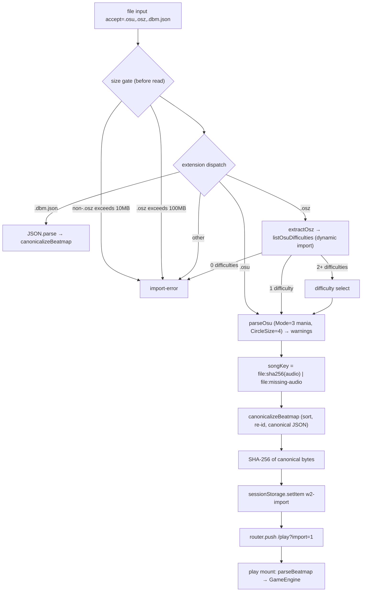

*Import pipeline from file input to engine — [SVG](diagrams/import-pipeline.svg) | [PNG](diagrams/import-pipeline.png)*

Entry is `onFileChange` (`web_app/game/apps/web/src/app/import/page.tsx:85-129`). The order of
gates is the design: **size caps before any `file.text()`/`JSON.parse`**, then extension
dispatch (lowercased name): `.dbm.json` → `JSON.parse` → `canonicalizeBeatmap`; `.osz` →
dynamic import `osz-import.js` → `extractOsz` → `listOsuDifficulties` (0 → error, 1 → parse
immediately, >1 → difficulty `<select>` then parse on pick); `.osu` → `file.text()` →
`runParse`; anything else → unsupported. `runParse` (`import/page.tsx:67-74`) dynamic-imports
`packages/beatmap-formats/src/index.js` **by relative path** — the package is intentionally not
in `@airhythm/web`'s dependencies (`import/page.tsx:65-68`) — then `parseOsu` (throws on
mode/4K violations) → `songKeyFor` → `candidateFromParsed` → `canonicalizeBeatmap` → warnings
+ `storeChart` (`sessionStorage.setItem("w2-import", canonicalJson(beatmap))`,
`import/page.tsx:60-63`).

Parser DoS caps live in `packages/beatmap-formats/src/osu-import.ts`: `MAX_NOTES = 10_000`,
`MAX_TIMING_POINTS = 10_000`, `MAX_TAGS = 64`, `MAX_PULSES = 100_000` (lines 22-31), enforced
with mid-parse aborts (lines 94, 138, 167); Mode must be 3 (lines 59-60) and CircleSize must
be 4 (lines 64-65). Dropped features (storyboard/SV/hitsounds/type bits) surface as
`ImportWarning[]` (`osu-import.ts:47-54`) and render in `/import` (`import/page.tsx:187-204`).

**Important code — size caps + `songKeyFor`**
(verbatim from `web_app/game/apps/web/src/app/import/page.tsx:17-40`):

```ts
const MAX_TEXT_FILE_BYTES = 10 * 1024 * 1024;
const MAX_OSZ_FILE_BYTES = 100 * 1024 * 1024;

async function sha256Hex(bytes: Uint8Array): Promise<string> {
  const copy = new Uint8Array(bytes); // ArrayBuffer-backed copy — satisfies BufferSource typing
  const digest = await crypto.subtle.digest("SHA-256", copy.buffer);
  return [...new Uint8Array(digest)].map((b) => b.toString(16).padStart(2, "0")).join("");
}

/** W2 contract: archive audio is hashed for songKey only — never stored, never played. */
async function songKeyFor(
  audioFilename: string | null,
  entries: Map<string, Uint8Array> | null,
): Promise<string> {
  if (!audioFilename || !entries) return MISSING_AUDIO_SONG_KEY;
  const target = audioFilename.toLowerCase();
  for (const [name, bytes] of entries) {
    if (name.endsWith("/")) continue; // directory entry
    if (name.toLowerCase().endsWith(".osu")) continue;
    const base = name.split("/").pop()?.toLowerCase(); // archives often prefix paths
    if (base === target) return `file:${await sha256Hex(bytes)}`;
  }
  return MISSING_AUDIO_SONG_KEY;
}
```

The caps are checked against `file.size` before the file is ever read (`import/page.tsx:90-94`),
mirroring `DEFAULT_ZIP_LIMITS.maxCompressedBytes` (100 MB) so `.osz` has the same ceiling at
both layers. `songKeyFor` implements the copyright-conscious contract: archive audio is
**hashed for identity only — never stored, never played** (the playback note at
`import/page.tsx:218-220` tells the user the click-track is used instead). Identity is
`file:<sha256-hex>` or the sentinel `file:missing-audio`.

Consumption on `/play?import=1`: mount reads `w2-import`, rejects
`raw.length > MAX_IMPORT_JSON_CHARS` (10 MB, mirrored at `play/page.tsx:25-27`), then
`parseBeatmap(JSON.parse(raw))`; failure → `importError` overlay, no renderer, no start
(`play/page.tsx:143-153,394-411`).

### `.osz` two-phase extraction

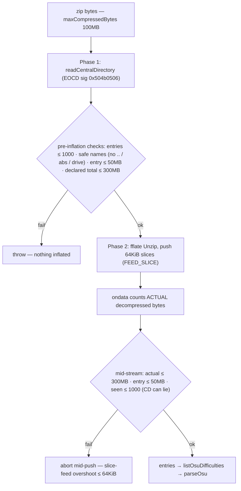

*Two-phase zip extraction: pre-scan then mid-stream accounting — [SVG](diagrams/osz-extraction-phases.svg) | [PNG](diagrams/osz-extraction-phases.png)*

Untrusted zips are the highest-risk import surface, so the design is two-phase by rule
(`DEFAULT_ZIP_LIMITS` = 100 MB compressed / 300 MB total uncompressed / 1000 entries / 50 MB
per entry, `packages/beatmap-formats/src/zip-limits.ts:8-13`): **Phase 1** parses the central
directory (EOCD scan) and enforces entry count, path safety, and *declared* sizes **before a
single byte inflates**; **Phase 2** streams through fflate's `Unzip`, counting *actual*
decompressed bytes inside `file.ondata` and aborting mid-stream when a cap crosses — because a
central directory can lie. Whole-archive `unzipSync()` on untrusted input is explicitly
prohibited (doc comment, `osz-import.ts:56-61`).

**Important code — two-phase `.osz` extraction**
(verbatim from `web_app/game/packages/beatmap-formats/src/osz-import.ts:56-114`):

```ts
/**
 * Two-phase .osz extraction (Review Focus 3):
 * Phase 1 — central-directory metadata scan BEFORE any inflation (entry count, names, declared sizes).
 * Phase 2 — streaming Unzip where ACTUAL output bytes are counted INSIDE the ondata callback,
 * aborting the moment a cap crosses. Whole-archive `unzipSync()` on untrusted input is prohibited.
 */
export function extractOsz(bytes: Uint8Array, limits: ZipLimits = DEFAULT_ZIP_LIMITS): { entries: Map<string, Uint8Array> } {
  if (bytes.byteLength > limits.maxCompressedBytes) throw new Error("osz: archive exceeds compressed-size limit");

  // PHASE 1 — PRE-INFLATE enforcement from central-directory metadata (nothing decompressed yet)
  const cd = readCentralDirectory(bytes);
  if (cd.length > limits.maxEntries) throw new Error(`osz: too many entries (limit ${limits.maxEntries})`);
  let declaredTotal = 0;
  for (const e of cd) {
    if (unsafeEntryName(e.name)) throw new Error(`osz: unsafe path rejected: ${e.name}`);
    if (e.uncompressedSize > limits.maxEntryBytes) throw new Error(`osz: entry exceeds per-entry limit: ${e.name}`);
    declaredTotal += e.uncompressedSize;
    if (declaredTotal > limits.maxTotalUncompressed) throw new Error("osz: cumulative decompressed limit exceeded");
  }

  // PHASE 2 — STREAMING inflation: accumulate ACTUAL output bytes INSIDE file.ondata
  // (during decompression — aborts mid-stream; a lying header that understated Phase 1 sizes
  //  is caught here, before the archive finishes inflating)
  const entries = new Map<string, Uint8Array>();
  let actualTotal = 0;
  let seen = 0;
  const uz = new Unzip((file) => {
    seen += 1; // CD count can lie — re-check against local headers as they stream in
    if (seen > limits.maxEntries) throw new Error(`osz: too many entries (limit ${limits.maxEntries})`);
    if (unsafeEntryName(file.name)) throw new Error(`osz: unsafe path rejected: ${file.name}`);
    if (file.name.endsWith("/")) return; // directory entry — nothing to extract
    const name = file.name;
    let chunks: Uint8Array[] = [];
    let entryBytes = 0;
    file.ondata = (err, data, final) => {
      if (err) throw new Error(`osz: extraction failed: ${err.message}`);
      if (data) {
        entryBytes += data.byteLength;
        actualTotal += data.byteLength; // DURING decompression
        if (entryBytes > limits.maxEntryBytes) throw new Error(`osz: entry exceeds per-entry limit: ${name}`);
        if (actualTotal > limits.maxTotalUncompressed) throw new Error("osz: cumulative decompressed limit exceeded");
        chunks.push(data);
      }
      if (final) {
        entries.set(name, concatUint8(chunks));
        chunks = [];
      }
    };
    file.start(); // decompression begins — subsequent ondata calls happen during push()
  });
  uz.register(UnzipInflate); // compression 0 (stored) is registered by default; 8 = deflate
  // Feed in slices so the decoder emits output incrementally and the cap checks inside
  // file.ondata fire mid-entry. Exactly one final=true: the last chunk, including the
  // exact-multiple case (chunk ends exactly at bytes.length, remainder loop stops).
  for (let i = 0; i < bytes.length; i += FEED_SLICE) {
    uz.push(bytes.subarray(i, i + FEED_SLICE), i + FEED_SLICE >= bytes.length);
  }
  return { entries };
}
```

Three defense layers in one function: compressed-size check before anything; Phase 1
pre-inflate rejection of unsafe paths (`unsafeEntryName`: `\`, drive letter, leading `/`, `..`
segments, `osz-import.ts:15-20`) and over-cap declarations; Phase 2 mid-stream accounting
inside `ondata` so a lying header is caught *during* decompression. The 64 KiB `FEED_SLICE`
loop bounds zip-bomb overshoot past any cap to roughly one slice's expansion — a single
`push(bytes, true)` would materialize a lying entry's entire output before the first `ondata`
fired (rationale at `osz-import.ts:7-13`).

---

## 7. Canonicalization / hash / round-trip

Everything user-supplied passes through one funnel: **normalize → validate → order → re-id →
canonical JSON → hash**. The canonical string is the format: `.dbm.json` *is*
`canonicalJson(beatmap)`, and `hashBeatmap` (SHA-256 of the UTF-8 canonical string) is the pin.

Sorting rules (the §12.1 ruling) are explicit because the two obvious implementations are
wrong: object keys and string fields use **code-unit** comparison (default `<` / `cmpStr`,
never `localeCompare` — locale-independent hashes), while numeric fields (`t`, `lane`,
`sourceId`) compare numerically (string compare misorders mixed digit counts).

**Important code — `stableStringify`, canonical ordering, `hashBeatmap`**
(verbatim from `web_app/game/packages/shared/src/canonical.ts:3-74`, stage-1 pre-sort and
pulses sort elided):

```ts
function stableStringify(value: unknown): string {
  if (value === null || typeof value !== "object") return JSON.stringify(value);
  if (Array.isArray(value)) return `[${value.map(stableStringify).join(",")}]`;
  const obj = value as Record<string, unknown>;
  const keys = Object.keys(obj).filter((k) => obj[k] !== undefined).sort(); // code-unit sort (default <), never localeCompare
  return `{${keys.map((k) => `${JSON.stringify(k)}:${stableStringify(obj[k])}`).join(",")}}`;
}

/** Code-unit string compare — locale-independent, required on canonical/hash paths. */
function cmpStr(a: string, b: string): number {
  return a < b ? -1 : a > b ? 1 : 0;
}
// ... (noteKey helper + defensive (t, id) pre-sort before schema validation omitted)
  const parsed = parseBeatmap(candidate);
  // snapshot source ids BEFORE reassignment (§12.1 step 3)
  const withSource = parsed.notes.map((n) => ({ note: { ...n, tier: n.tier ?? "primary" }, sourceId: n.id }));
  withSource.sort((a, b) => {
    const ka = noteKey(a.note, a.sourceId), kb = noteKey(b.note, b.sourceId);
    for (let i = 0; i < ka.length; i++) {
      // ruling §12.1: t/lane/sourceId numeric (string compare misorders mixed digit counts);
      // type/tier code-unit strings
      const va = ka[i], vb = kb[i];
      const r = typeof va === "number" && typeof vb === "number"
        ? va - vb
        : cmpStr(String(va), String(vb));
      if (r !== 0) return r;
    }
    return 0;
  });
  const notes = withSource.map((x, i) => ({ ...x.note, id: i })); // step 4
  const timing = [...parsed.timing].sort((a, b) => a.t - b.t || a.bpm - b.bpm || a.meter - b.meter);
  // ... (pulses sort: (t, s, k code-unit, sourceIdx) omitted)
  return { ...parsed, notes, timing, pulses };
}

export function canonicalJson(b: Beatmap): string {
  return stableStringify(b);
}

export async function hashBeatmap(canonical: string): Promise<string> {
  const digest = await crypto.subtle.digest("SHA-256", new TextEncoder().encode(canonical));
  return [...new Uint8Array(digest)].map((b) => b.toString(16).padStart(2, "0")).join("");
}
```

`canonicalizeBeatmap` (`canonical.ts:26-65`) defensively pre-sorts notes by `(t, id)` before
schema validation (the zod `superRefine` requires t-sorted input), validates, snapshots
`sourceId`s, sorts by the full note key `(t, lane, type, tier, sourceId)` with the
numeric-vs-code-unit split, and re-ids `0..n-1` — so identical charts from different tools
produce byte-identical canonical JSON. The schema itself (`packages/shared/src/beatmap.ts:22-94`)
enforces version literal 1, dup ids, `t ≤ durationMs`, hold `d` within duration, no overlapping
holds per lane, and pulses/timing within duration; `parseBeatmap` throws
`Invalid beatmap: path — message` (`beatmap.ts:99-106`).

**Important code — `.osu` export round-trip contract**
(verbatim from `web_app/game/packages/beatmap-formats/src/export.ts:12-48`):

```ts
/**
 * v14 mania export (Mode 3 — spec §5.2 "Mode:4" is a recorded typo).
 * Known gaps: no SV export, no hitsounds — spec §5.2.
 */
export function exportOsu(b: Beatmap, audioFilename: string): string {
  const lines: string[] = [];
  lines.push("osu file format v14", "", "[General]");
  lines.push(`AudioFilename: ${audioFilename}`, "Mode: 3", "", "[Metadata]");
  lines.push(
    `Title:${b.meta.title}`,
    `Artist:${b.meta.artist}`,
    `Creator:${b.meta.creator}`,
    `Version:${b.meta.difficulty}`,
    `Tags:${b.meta.tags.join(" ")}`,
    `PreviewTime:${b.meta.previewMs}`,
    "",
    "[Difficulty]",
  );
  lines.push(
    "HPDrainRate:5",
    "CircleSize:4",
    "OverallDifficulty:8",
    "ApproachRate:9",
    "SliderMultiplier:1.4",
    "SliderTickRate:1",
    "",
    "[TimingPoints]",
  );
  for (const t of b.timing) lines.push(`${t.t},${60_000 / t.bpm},${t.meter},2,0,60,1,0`); // full float precision — no quantization
  lines.push("", "[HitObjects]");
  for (const n of b.notes) {
    const x = Math.round(((n.lane + 0.5) * 512) / 4);
    if (n.type === "hold") lines.push(`${x},192,${n.t},128,0,${n.t + (n.d ?? 0)}:0:0:0:0:`);
    else lines.push(`${x},192,${n.t},1,0,0:0:0:0:`);
  }
  return lines.join("\n") + "\n";
}
```

Export writes **`Mode: 3`** (the spec's "Mode:4" is a recorded typo, comment lines 12-15),
`CircleSize:4`, timing as `60_000/bpm` at full float precision (no quantization — quantized
timing would shift round-trip charts), hold tail payload as `t+d`, and no SV/hitsounds (known
gaps). `.dbm.json` export is just `canonicalJson` bytes (`export.ts:3-6`); `importDbm`
re-canonicalizes (`export.ts:8-10`). The round-trip contract is exercised by
`packages/beatmap-formats/src/roundtrip.test.ts`.

---

## 8. Rendering (WebGL sync core, atlas opportunistic)

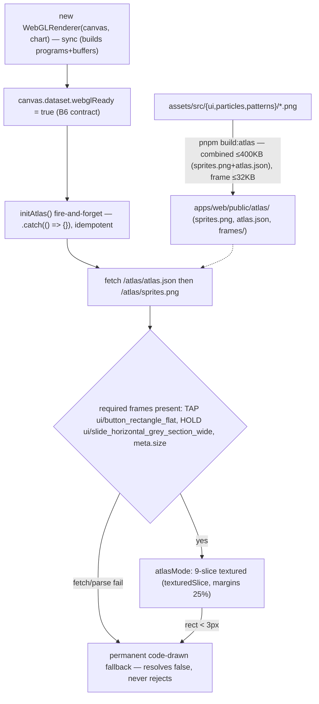

*Renderer construction and the opportunistic atlas path — [SVG](diagrams/renderer-atlas-path.svg) | [PNG](diagrams/renderer-atlas-path.png)*

`WebGLRenderer implements Renderer`
(`web_app/game/apps/web/src/engine/renderer-webgl.ts:30`). The architectural rule: **the
constructor is synchronous and complete** — WebGL2 context (throws if unavailable,
`renderer-webgl.ts:64-65`), solid program + buffers, blend state, note color read from CSS
`--you` with byte-equal fallback, *plus* the textured program/buffer (`renderer-webgl.ts:67-91`).
Only texture loading is async. That is what makes the B6 `webglReady` contract possible: when
the attribute is set, *everything except pixels* is ready, with no await in between.

- `resize()` sets `u_res` on both programs in CSS px (HiDPI note `renderer-webgl.ts:107-109`);
  highway width `min(480, w*0.4)`, `hitLineY = h*0.82` (`renderer-webgl.ts:110-114`).
- `noteY` implements the §2.8 position rule
  `y = hitLineY − (noteT − chartTime)*scrollPxPerMs`, `SCROLL_PX_PER_MS = 0.5`
  (`renderer-webgl.ts:26-28,5`).
- `render(chartTimeMs, noteStates)` (`renderer-webgl.ts:117-180`): clear → code-drawn lane
  panels/receptors/hit line ("drawn in code, no sprites") → **pending notes only**, off-screen
  cull, hold body @0.35 alpha + head → two batches: solid draw, then textured draw if the atlas
  loaded. Attribs are re-bound per draw because the textured pass overwrites shared slots
  (`renderer-webgl.ts:194-217`).
- **Code-drawn fallback**: every note tries `texturedSlice` first and falls back to `quad` when
  there's no atlas / too-small rect / batch full (`renderer-webgl.ts:144-157`);
  `texturedSlice` returns `false` instead of letting `nineSliceRect` throw
  (`renderer-webgl.ts:240-244`). Gameplay never depends on art arriving.

**Important code — `initAtlas`: idempotent, never-rejecting, commit-last**
(verbatim from `web_app/game/apps/web/src/engine/renderer-webgl.ts:262-316`, texture upload elided):

```ts
  /**
   * Opportunistic atlas load (W2 T22, spec §6.4) — NEVER on the readiness path: the play
   * page fires this right after setting webglReady with its rejection consumed. Idempotent
   * via `atlasInitStarted`: a second call returns the in-flight/settled promise, so state
   * transitions at most once and concurrent calls can't race. Resolves false on any failure
   * → the renderer stays code-drawn permanently; a settled-true atlas is never cleared
   * (no mid-play revert). Never rejects.
   */
  initAtlas(): Promise<boolean> {
    if (this.atlasInitStarted && this.atlasInitPromise) return this.atlasInitPromise;
    this.atlasInitStarted = true;
    this.atlasInitPromise = this.loadAtlas();
    return this.atlasInitPromise;
  }

  private async loadAtlas(): Promise<boolean> {
    try {
      const res = await fetch("/atlas/atlas.json");
      if (!res.ok) return false;
      const json = (await res.json()) as AtlasJson;
      const tapRect = json.frames[TAP_FRAME];
      const holdRect = json.frames[HOLD_FRAME];
      const size = json.meta?.size;
      if (!tapRect || !holdRect || !size?.width || !size?.height) return false;
      const imgRes = await fetch("/atlas/sprites.png");
      if (!imgRes.ok) return false;
      // ... (createImageBitmap + GL texture upload omitted)
      if (this.disposed) {
        // Strict Mode remount can dispose the renderer mid-load — don't leak the texture
        gl.deleteTexture(tex);
        return false;
      }
      // commit LAST: success-only state transition (atlasFrames/atlasTex are never cleared)
      this.atlasTex = tex;
      this.atlasSize = { w: size.width, h: size.height };
      this.atlasFrames = { tap: withSlice(tapRect), hold: withSlice(holdRect) };
      return true;
    } catch {
      return false;
    }
  }
```

Four guarantees in one method: idempotent (single `atlasInitStarted` transition), **never
rejects** (`catch → false`) so the play page's `.catch(() => {})` can never see an unhandled
rejection in the B6 e2e, **commit-last** so a settled-true atlas is never cleared mid-play, and
disposed-mid-load cleanup so Strict Mode remounts don't leak textures. Required frames are
`TAP_FRAME = "ui/button_rectangle_flat"` and `HOLD_FRAME =
"ui/slide_horizontal_grey_section_wide"` (`renderer-webgl.ts:13-14`), fetched from
`/atlas/atlas.json` + `/atlas/sprites.png` (`renderer-webgl.ts:279,286`). 9-slice margins are
derived at load as 25% of frame dims (`withSlice`, `renderer-webgl.ts:344-348`);
`nineSliceRect` is pure geometry that throws only below 3×3 px
(`web_app/game/apps/web/src/engine/slice9.ts:8-35`), with UVs converted sprite-local →
atlas-absolute → normalized (`renderer-webgl.ts:250-257`).

Atlas build: `packages/assets/src/build-atlas.ts` walks `assets/src/{ui,particles,patterns}/**/*.png`
with **code-unit sort** (lines 18-29), fixed generator string `"atlas/1"` (never a timestamp,
lines 48-49), deterministic shelf packing (`pack.ts:4-21`), and emits `sprites.png` +
`atlas.json` + `frames/**.png` into `apps/web/public/atlas/` (lines 67-74) — under a **budget
gate**: combined sheet+json ≤ 400 KB, per-frame ≤ 32 KB, exit 1 with sizes
(`COMBINED_MAX`/`FRAME_MAX`, lines 11-12; enforcement 76-85).

Perf: `PerfMonitor` tracks p95 render/update/frame-interval against `RENDER_BUDGET_MS = 16.7`
(`web_app/game/apps/web/src/engine/perf.ts:2-29`); the report prints at freeze
(`play/page.tsx:346-355`).

---

## 9. Assets / license chain

Every shipped image needs a provenance row. The manifest is
`web_app/game/assets/ASSETS.csv` — Kenney **CC0** rows for `particle-pack` (line 2),
`pattern-pack-lines` (line 198), `ui-pack` (line 396); the curated atlas inputs
(`button_rectangle_flat`, `slide_horizontal_grey_section_wide`, `input_rectangle`, plus
`assets/src/patterns/**`) are copied in per CSV lines 392-395.

`scripts/check-assets.mjs` is the gate:

- Walks **3 roots**: `<root>/assets`, `<root>/public`, `<root>/apps/web/public>`
  (`check-assets.mjs:58`).
- Every file needs an `ASSETS.csv` row (header parse `check-assets.mjs:49-56`) with license in
  the allow-list `CC0 | CC-BY-4.0 | CC-BY-3.0 | ISC | MIT | OFL | owned` (line 33); any
  `CC-BY*` row must carry non-empty `attribution_text` (line 66).
- **Exemptions** (no row needed): `favicon*`, `robots.txt`, `manifest*`, `*.html`, and the CSV
  itself (`EXEMPT`, line 34; rationale header 15-22).
- Naive `split(",")` CSV parsing is a documented deliberate limitation (lines 24-27).
- Offenders print and `exit 1` (lines 59-69).

CI ordering matters: the check job runs `pnpm build:atlas` **then**
`node scripts/check-assets.mjs` — "plan T24 order: atlas first, license gate second"
(`.github/workflows/web-game-ci.yml:28-30`) so freshly generated atlas files are themselves
checked. Same order in the local chain (`web_app/game/README.md:26-30`). Checker fixtures
(clean/dirty/dirty-public) live in `web_app/game/scripts/fixtures/assets-check/`.

---

## 10. Worker (`apps/worker`)

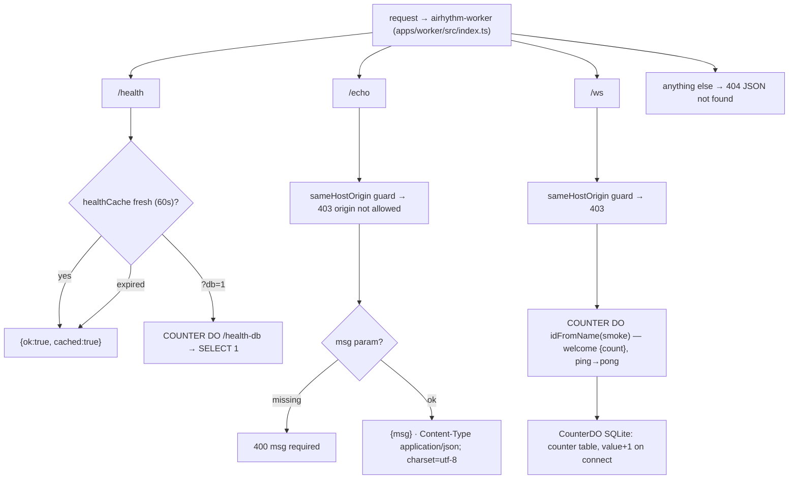

*Worker endpoints, origin gate, and DO counter — [SVG](diagrams/worker-endpoints.svg) | [PNG](diagrams/worker-endpoints.png)*

Endpoints (`web_app/game/apps/worker/src/index.ts`):

- `GET /health` → isolate-local TTL cache (60 s, `health-cache.ts:1-10`), `{ok, cached}`
  (`index.ts:20-29`); `GET /health?db=1` bypasses cache → DO `SELECT 1` (`index.ts:30-34`).
- `GET /echo?msg=` → `{msg}` with explicit JSON content type — "kills MIME-sniff reflection"
  (`index.ts:36-41,72-78`).
- `GET /ws` → upgrade proxied to the DO (`index.ts:43-51`); anything else → 404 (`index.ts:53`).

**Origin gate**: `sameHostOrigin` guards `/echo` and `/ws` (`index.ts:37,44,62-70`) — a
browser-sent `Origin` must match the request host; **missing Origin = non-browser client,
allowed** (comments `index.ts:12-15,57-61`); unparseable Origin (e.g. `null`) rejected
(`index.ts:66-69`).

**Durable Object** (`src/counter-do.ts`): `CounterDO` class form (lines 1-14), SQL table
`counter` singleton row (lines 10-13); `/health-db` → `SELECT 1` (lines 17-19); non-WS upgrade
→ 426 (lines 21-23); on WS connect, read-modify-write increment (atomic without a transaction
because sync SQLite, comment lines 28-31) then `{type:"welcome", count}` (lines 32-36);
`ping`→`pong`, echo otherwise (lines 39-42). The DO name is deterministic `"smoke"` — never
unique-per-run, because stored DOs are never GC'd (`index.ts:44-48`); counts therefore
accumulate across deploys, and `scripts/smoke.mjs` asserts **relative** increments
(`smoke.mjs:9-12,64-69`).

**No auth by design** — deferred to W4; the Origin check is the only hardening
(`index.ts:12-14`). Binding/migration: `wrangler.toml:5-11`.

---

## 11. CI gates

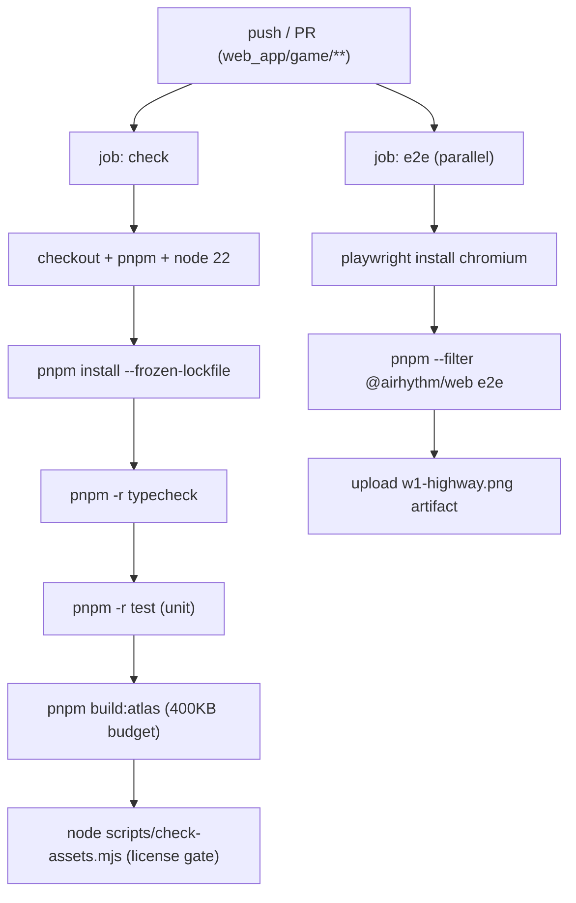

*CI jobs and gate order — [SVG](diagrams/ci-gate-chain.svg) | [PNG](diagrams/ci-gate-chain.png)*

Workflow `.github/workflows/web-game-ci.yml` triggers on `web_app/game/**` + itself (lines 4-7),
working-directory `web_app/game` (lines 12-14); the pnpm pin is read from the **nested**
`package.json` (comment line 19), Node 22 + pnpm cache on the nested lockfile (lines 20-24).

- **Job `check`** (lines 10-30): `pnpm install --frozen-lockfile` → `pnpm -r typecheck` →
  `pnpm -r test` → `pnpm build:atlas` (T24 order: atlas first) → `node scripts/check-assets.mjs`
  (license gate second).
- **Job `e2e`** (lines 31-53): install → `playwright install --with-deps chromium` →
  `pnpm --filter @airhythm/web e2e` → upload `e2e/screenshots/w1-highway.png` always
  (lines 46-53). Playwright's webServer runs `pnpm build && pnpm start` with
  `NEXT_PUBLIC_E2E=1` (`web_app/game/apps/web/playwright.config.ts:17-26`); testDir
  `web_app/game/e2e` (specs: `w1-highway`, `w2-sync`, `w2-import`, `w2-style-check`;
  `playwright.config.ts:4-5`).

### How to run / verify

Setup and full gate chain (from `web_app/game/README.md:3-30`, plan T24 order — the same six
gates CI runs, as one serial chain):

```sh
corepack enable
cd web_app/game
pnpm install
pnpm -r typecheck && pnpm -r test && pnpm --filter @airhythm/web build && pnpm --filter @airhythm/web exec playwright test && pnpm build:atlas && pnpm check:assets
```

Day-to-day: `pnpm --filter @airhythm/web dev` (http://localhost:3000),
`pnpm --filter @airhythm/worker dev` (wrangler). The click-track fixture is gitignored —
regenerate with `pnpm --filter @airhythm/web gen:audio` (Playwright global setup also
regenerates it when missing, `web_app/game/README.md:34`). Worker post-deploy smoke:
`WORKER_URL=… node scripts/smoke.mjs` (`web_app/game/README.md:14`). `--webpack` remains
required (D15) until import specifiers are rewritten (`web_app/game/README.md:36`).

---

## 12. Security posture

**Important code — security headers on every route**
(verbatim from `web_app/game/apps/web/next.config.ts:7-30`):

```ts
const securityHeaders = [
  { key: "X-Frame-Options", value: "DENY" },
  { key: "Referrer-Policy", value: "strict-origin-when-cross-origin" },
  { key: "X-Content-Type-Options", value: "nosniff" },
  {
    key: "Content-Security-Policy",
    value: [
      "default-src 'self'",
      "img-src 'self' data: blob:",
      "style-src 'self' 'unsafe-inline'", // Next injects inline styles
      "script-src 'self' 'unsafe-inline' 'unsafe-eval'", // permissive script — see note above
      "connect-src 'self'", // fetch/audio/atlas are same-origin
    ].join("; "),
  },
];

const nextConfig: NextConfig = {
  reactStrictMode: true,
  transpilePackages: ["@airhythm/shared"], // shared exports raw .ts — let Next compile it instead of failing at first build
  experimental: {
    // shared's index.ts uses ESM-style "./x.js" specifiers over .ts sources; webpack has no default .js→.ts alias (tsc/vite do)
    extensionAlias: { ".js": [".js", ".ts", ".tsx"], ".jsx": [".jsx", ".tsx"] },
  },
  headers: async () => [{ source: "/(.*)", headers: securityHeaders }],
};
```

Headers apply to all routes via `headers()` (`next.config.ts:30`). CSP `script-src` carries
`'unsafe-inline' 'unsafe-eval'` — permissive by necessity for Next dev tooling/hydration,
documented as such (`next.config.ts:3-6`); HSTS is left to Vercel (comment line 6).
`connect-src 'self'` keeps fetch/audio/atlas same-origin (line 18).

Full posture summary:

- **Import caps** — text 10 MB / `.osz` 100 MB checked before read
  (`import/page.tsx:13-18,90-94`); zip limits 100 MB / 300 MB / 1000 entries / 50 MB per entry
  re-checked inside extraction (`zip-limits.ts:8-13`; `osz-import.ts:63,67,71-73,84,95-96`);
  zip-bomb bounded by mid-stream accounting + 64 KiB slices (`osz-import.ts:13,76-113`); path
  traversal rejected pre- and mid-extract (`osz-import.ts:15-20,70,85`); parser DoS caps
  (10k notes / 10k timing / 64 tags / 100k pulses) with mid-parse aborts
  (`osu-import.ts:25-31,94,138,167`).
- **Headers** — as embedded above (`next.config.ts:7-30`).
- **sessionStorage** — write path only accepts schema-validated canonical JSON from the
  size-gated import (`import/page.tsx:60-63,96-99`); read path enforces
  `MAX_IMPORT_JSON_CHARS` = 10 MB before `JSON.parse` (`play/page.tsx:27,145-148`).
- **localStorage calibration** — ±500 ms validity gate prevents corrupt values becoming the
  gameplay offset silently (`calibration-store.ts:7,16-19`); `saveCalibration` throws
  out-of-range (`calibration-store.ts:26-29`).
- **E2E debug-hook gating** — `window.__w2` (live chartTime/playback/phase side-channel) is
  installed only in dev or when `NEXT_PUBLIC_E2E === "1"` (`play/page.tsx:174-191`); production
  Vercel builds leave it unset → absent (comment `play/page.tsx:176-177`); Playwright sets the
  flag only on its webServer build (`playwright.config.ts:22-25`); deleted on unmount
  (`play/page.tsx:221`).
- **Worker** — Origin check on stateful endpoints (`index.ts:36-44,62-70`), no auth yet by
  design/W4 deferral (`index.ts:12-14`), explicit JSON content-types (`index.ts:40,72-78`),
  deterministic single DO to avoid unbounded persistent DOs (`index.ts:44-48`).
- **Untrusted beatmaps** — zod `superRefine` validation before any engine use
  (`beatmap.ts:51-94`; `parseBeatmap` `beatmap.ts:99-106`); renderer only draws pending notes
  within cull bounds (`renderer-webgl.ts:137-140`).

---

## Where to change what

| Task | Primary touch point | Also check |
|---|---|---|
| New/changed judge window | `packages/shared/src/constants.ts` `JUDGE_WINDOWS` (auto-miss + selection follow) | `TAIL_WINDOW_MS` in `engine/engine.ts:9`; grade tests |
| New grade / score weight | `packages/shared/src/constants.ts` `SCORE_WEIGHTS`, `judgement.ts` `grade()` | combo bonus cap in `comboMultiplier` (`judgement.ts:12-16`) |
| New route / page | `apps/web/src/app/<name>/page.tsx` | link from `app/page.tsx`; route list `web_app/game/README.md:32`; CSP/headers auto-apply (`next.config.ts:30`) |
| Swap / add art | PNGs under `packages/assets/src/{ui,particles,patterns}` + row in `assets/ASSETS.csv` | `pnpm build:atlas` budget gate (400 KB/32 KB); frame names in `renderer-webgl.ts:13-14`; `check:assets` |
| Timing formula change | `apps/web/src/engine/time-math.ts` only | keep "applied EXACTLY ONCE" — `audio-clock.ts:39`, resync `server-time.ts:33-43` |
| New import cap | `zip-limits.ts` + size gates `import/page.tsx:13-18` | mirror `MAX_IMPORT_JSON_CHARS` `play/page.tsx:27` |
| New worker endpoint | `apps/worker/src/index.ts` | add `sameHostOrigin` for any stateful route; smoke `scripts/smoke.mjs` |
| New CI gate | `.github/workflows/web-game-ci.yml` (job `check`) | mirror in local chain `web_app/game/README.md:26-30` (keep atlas → license order) |
| Play pause/resume behavior | `play/page.tsx` `pauseGame`/`resumeGame` | flush-before-pause ordering `controller.ts:35-43` (test-asserted); `SoloPauseController` |
| Security header change | `apps/web/next.config.ts` `securityHeaders` | document deviations in the comment block above it |

---

*Generated at HEAD `74f6d0a`. Diagram sources: [`diagrams/README.md`](diagrams/README.md).
If code and this document disagree, the code and its tests win — then fix the document.*


