# AIRhythm web_app — architecture diagram set

Mermaid sources rendered via the gstack `diagram` skill. Each diagram has:
`<name>.mmd` (source, single source of truth) · `<name>.svg` / `<name>.png` (render) · `<name>.excalidraw` (editable at excalidraw.com).

Boxes/arrows verified against `web_app/game/` code at HEAD `74f6d0a` (specs `2026-10-03-web-app-week-1-design.md` / `2026-10-06-web-app-week-2-design.md` predate implementation where they disagree).

## Diagrams

## monorepo-layers

Workspace root, the five packages, and who-imports-whom (workspace deps vs the deliberate relative dynamic import).

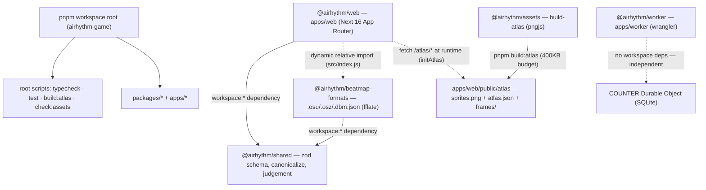

## routes-pages

The four routes and the sessionStorage hand-off between `/import` and `/play`.

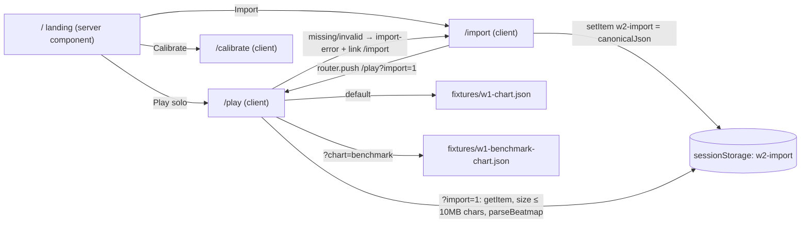

## play-phase-state-machine

`/play` phase transitions from click-to-start through countdown, pause/resume, and engine freeze (freeze keeps the `playing` phase).

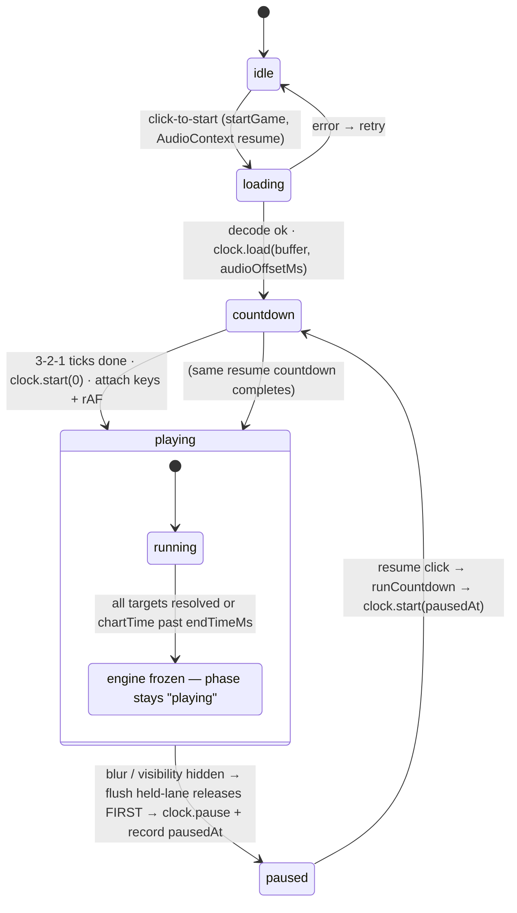

## timing-domains

The three time domains (perf ↔ AudioContext ↔ chart) and the "audioOffsetMs applied EXACTLY ONCE" rule, plus the calibrated judgeDt.

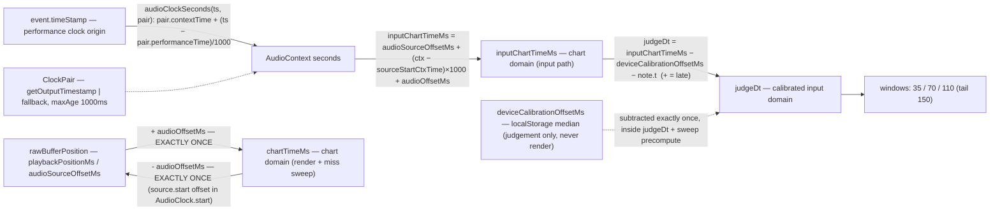

## judgement-pipeline

Keydow path from event.timeStamp through the dual-domain expiry sweep, calibrated candidate selection, grading, and the HUD snapshot.

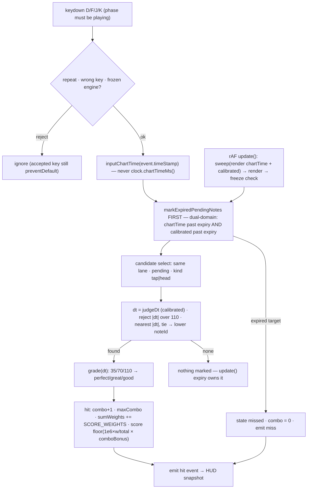

## hold-lifecycle

Hold notes as head+tail targets: keyup grading, early/late rules, auto-miss independence from head outcome, and the blur flush-before-pause ordering.

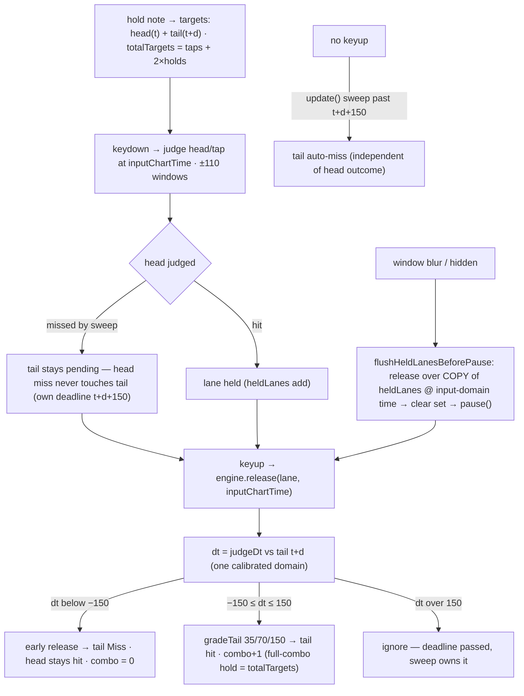

## import-pipeline

File input through size gates, extension dispatch, songKey hashing, canonicalization, sessionStorage, and consumption on `/play`.

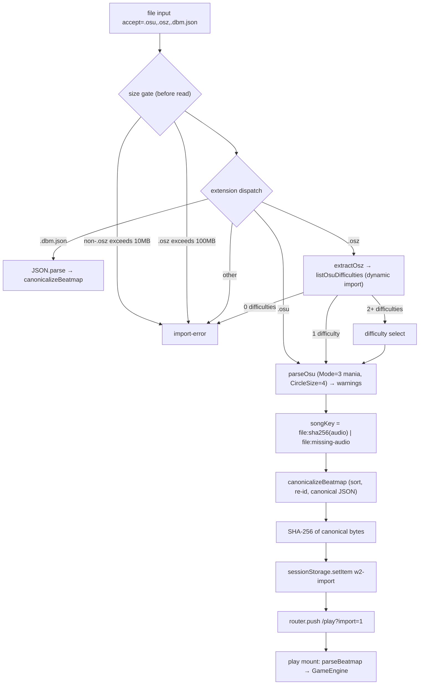

## osz-extraction-phases

Two-phase zip extraction: central-directory pre-scan before any inflation, then mid-stream actual-byte accounting with 64 KiB feed slices.

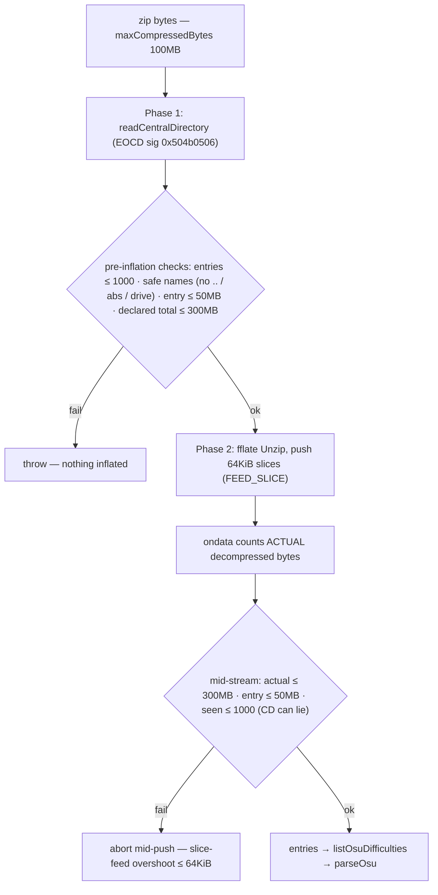

## renderer-atlas-path

Atlas build budget, synchronous renderer construction behind the B6 `webglReady` contract, and the never-rejecting opportunistic atlas load with permanent code-drawn fallback.

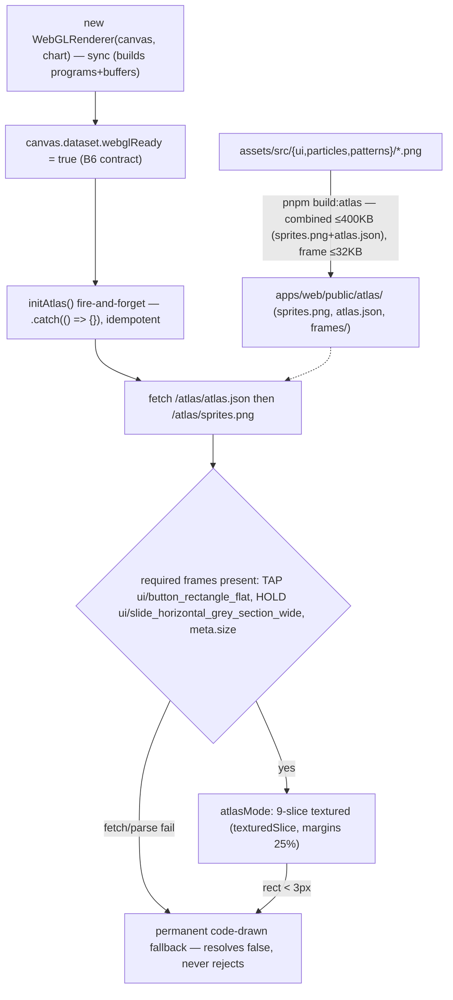

## calibration-flow

Calibration loop: metronome taps through pairing and median to localStorage, then consumption at engine construction inside judgeDt.

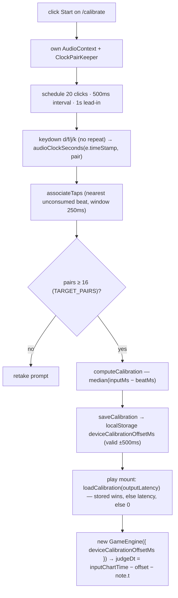

## worker-endpoints

Worker routes with the 60 s health cache, same-origin gate on stateful endpoints, and the deterministic `smoke` Durable Object counter.

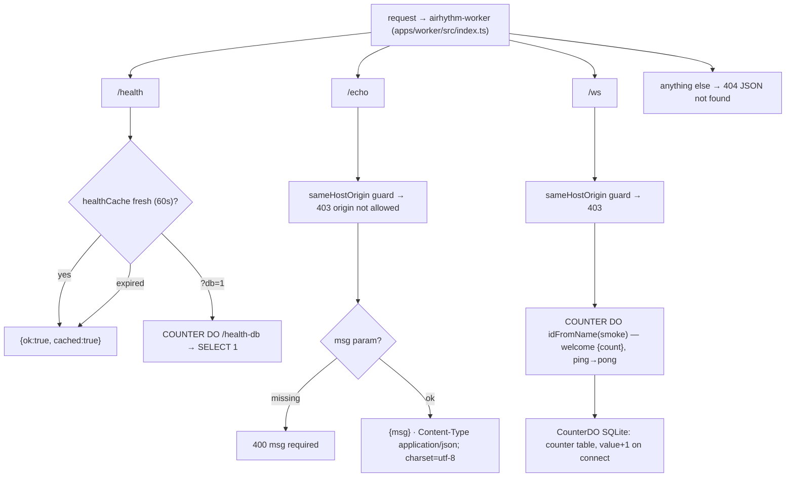

## ci-gate-chain

CI jobs on `web_app/game/**` pushes: parallel `check` (typecheck → test → atlas → license gate) and `e2e` (Playwright + artifact upload).

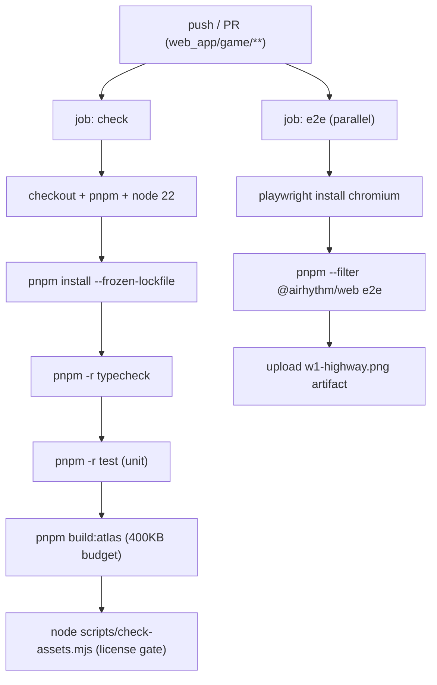

## Notes

- Edit any diagram by changing its `.mmd`, then re-render (mermaid is the source of truth). The `.excalidraw` files open at excalidraw.com (File → Open) for manual layout edits.
- Keep diagrams ≤ ~20 nodes; split rather than clutter.
- Embedded copies of all 12 sources also live in `../WEB-APP-ARCHITECTURE.md` at their topical sections — keep the two in sync when editing a `.mmd`.
